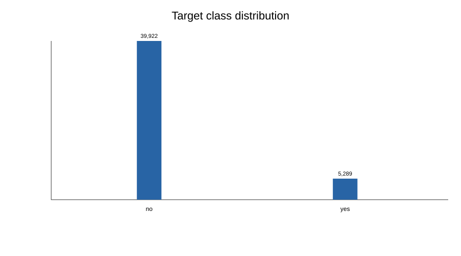
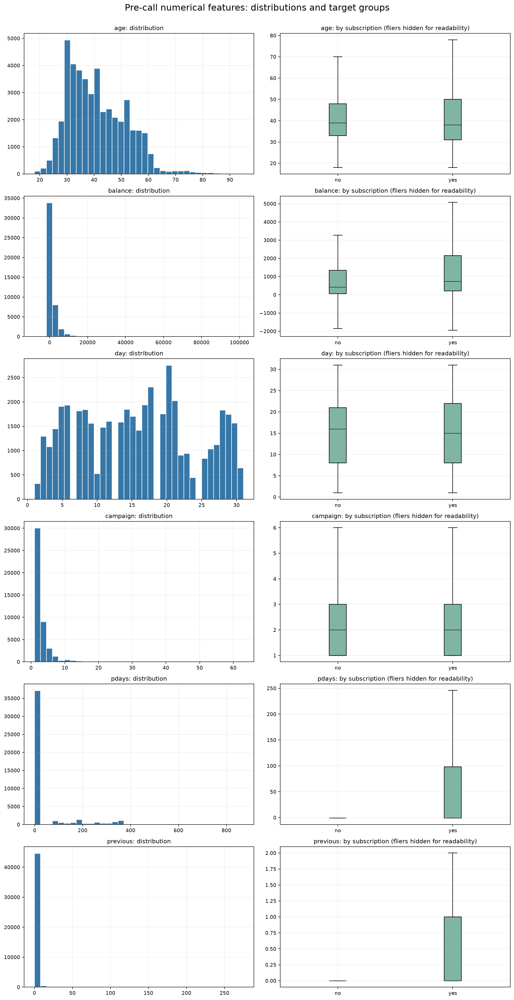
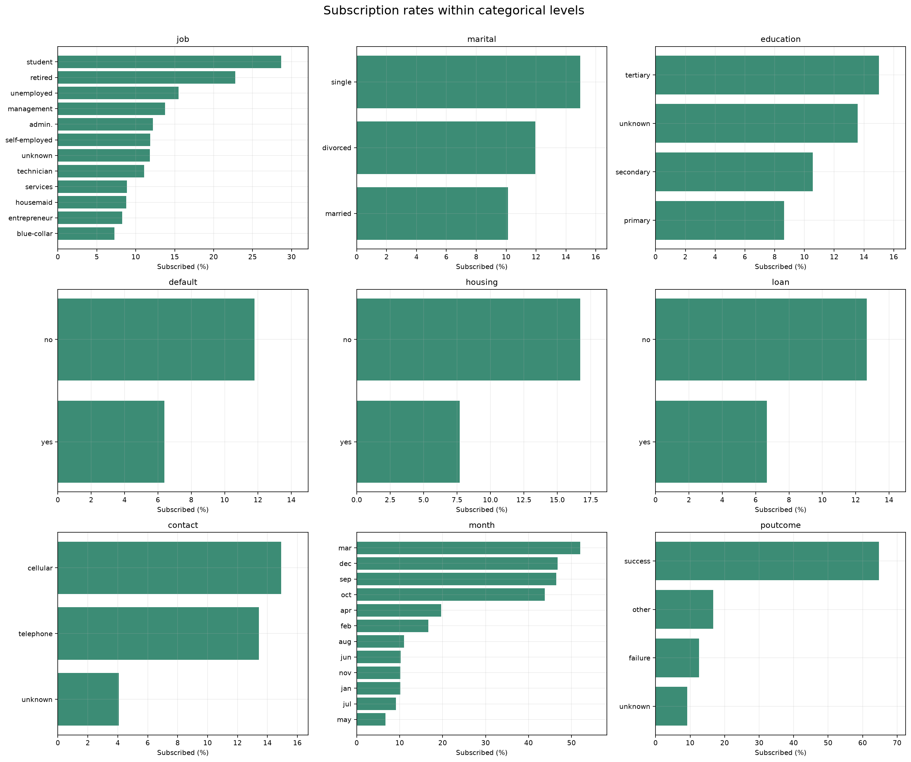
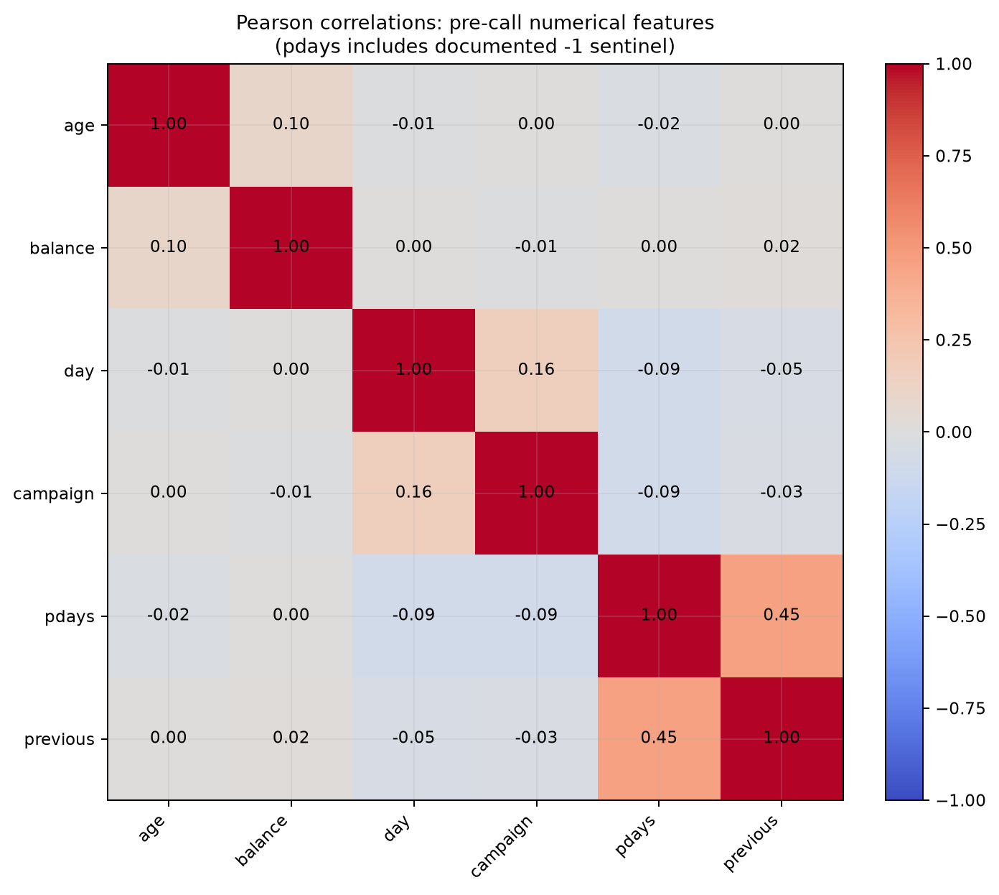
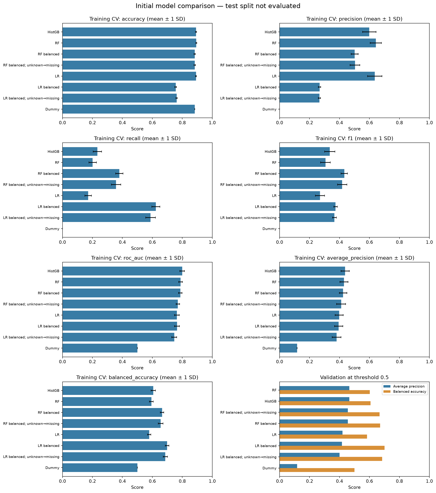
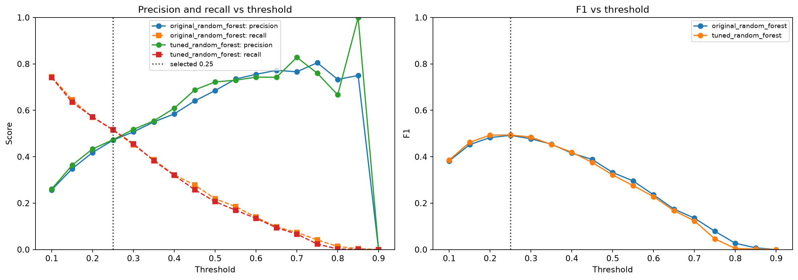
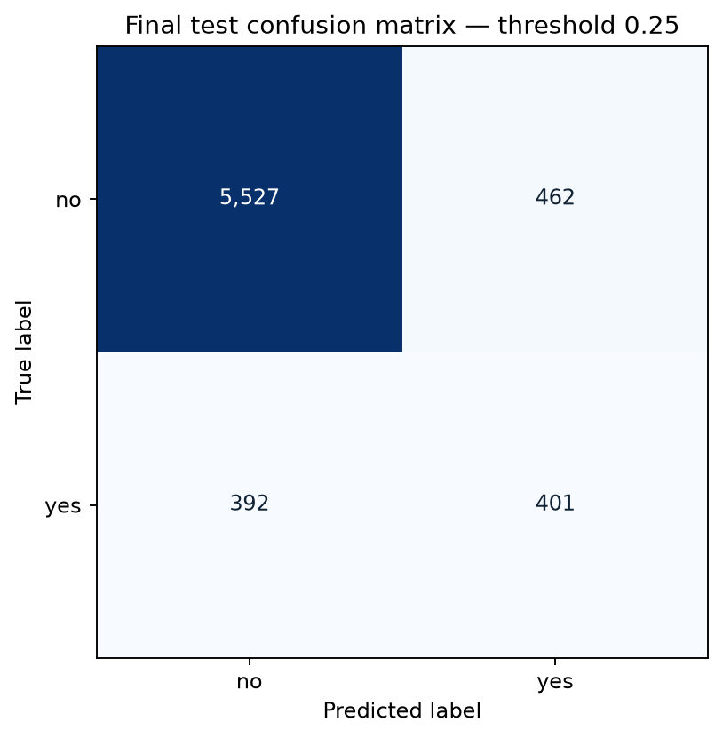
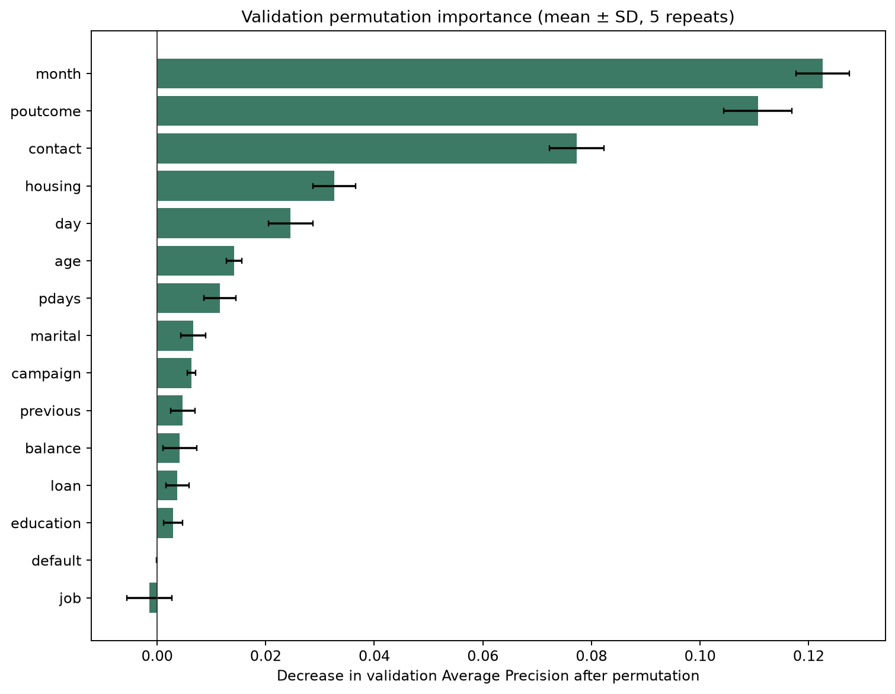

# Bank Marketing Subscription Prediction Using Machine Learning

**Undergraduate Engineering Project Report**  
**Project area:** Electronics and Communication Engineering / Data Science  
**Dataset:** UCI Bank Marketing (`bank-full.csv`)  
**Final model:** tuned Random Forest, decision threshold 0.25  
**Date:** 16 November 2026

---

## Abstract

This project develops and evaluates a binary classifier for predicting whether a client of a Portuguese bank subscribed to a term deposit after a direct-marketing campaign. The work uses the 45,211-row, 17-column `bank-full.csv` dataset from the UCI Machine Learning Repository. The positive class is `yes`, representing a subscription. An initial audit found no blank values or exact duplicate rows, while documented `unknown` categories and the `pdays=-1` sentinel required careful interpretation. Exploratory analysis showed an imbalanced target (7.55:1 no-to-yes), skewed numerical variables, and useful associations with previous-campaign outcomes.

The data was split stratified into 70% training, 15% validation, and 15% test partitions with seed 42. All model preprocessing was placed inside scikit-learn pipelines, and `duration` was excluded because it is measured after the current call and is unavailable for the intended pre-call prediction. Candidate classifiers were compared using five-fold stratified cross-validation on training data. A 20-configuration RandomizedSearchCV then tuned the Random Forest using Average Precision. The validation-selected model was refitted on training plus validation data and evaluated once on the untouched test partition. At the validation-selected threshold of 0.25, the test Average Precision was 0.4624, ROC-AUC was 0.7926, F1-score was 0.4843, and balanced accuracy was 0.7143. Test recall for subscribers was 0.5057, showing a useful but imperfect ability to identify positive cases. Validation permutation importance ranked month, previous campaign outcome, and contact type highest; these are model associations rather than causal effects.

**Keywords:** Bank marketing, binary classification, Random Forest, class imbalance, Average Precision, threshold selection, data leakage.

## 1. Introduction

### 1.1 Background

Direct marketing by telephone is used by financial institutions to promote products such as term deposits. Campaign resources are limited, so an estimate of which clients may subscribe can help prioritize outreach. Machine learning can learn patterns in historical campaign records, but evaluation must reflect when the prediction is made and how the positive class is valued.

### 1.2 Problem statement

Given a client's attributes and available campaign history, estimate whether the client will subscribe to a term deposit. This is a supervised binary classification task with target variable `y` and positive label `yes`. The operational scenario is prediction **before** the next marketing call.

### 1.3 Motivation

The target is imbalanced, and a high accuracy score can be obtained by predicting the majority class. Therefore, this project compares threshold-independent ranking metrics and threshold-dependent precision, recall, F1, and balanced accuracy. A validation-set threshold is selected explicitly to make the precision–recall trade-off visible.

### 1.4 Objectives

1. Verify and audit the supplied data and document special values.
2. Describe target relationships and distributions without deleting observations automatically.
3. Build leakage-aware preprocessing and compare a dummy baseline, Logistic Regression, Random Forest, and HistGradientBoosting.
4. Tune a modest Random Forest search using training-only cross-validation.
5. Choose a model and threshold using validation data, then report one final evaluation on the test partition.
6. Interpret validation permutation importance and document project limitations.

### 1.5 Scope

The project covers data validation, EDA, preprocessing design, initial model comparison, targeted Random Forest optimization, threshold analysis, final evaluation, and feature interpretation. It does not claim causal effects, deploy a bank decision system, or assess the value of a campaign intervention. The final test result was not used to revise the model or threshold.

## 2. Dataset Description

### 2.1 Source and citation

The project uses the legacy full Bank Marketing dataset, `bank-full.csv`, downloaded from the [UCI Machine Learning Repository](https://archive.ics.uci.edu/dataset/222/bank%2Bmarketing), dataset DOI [10.24432/C5K306](https://doi.org/10.24432/C5K306). UCI lists the dataset under the Creative Commons Attribution 4.0 International (CC BY 4.0) license. The accompanying `bank-names.txt` describes 45,211 instances, 16 inputs, and one output variable. The source describes Portuguese bank telephone campaigns and notes the data rows are ordered by date from May 2008 to November 2010.

### 2.2 Dimensions, target, and class distribution

The file contains **45,211 rows and 17 columns**. The target `y` indicates term-deposit subscription. There are **39,922 no records (88.30%)** and **5,289 yes records (11.70%)**, a ratio of 7.55:1. The minority class is the positive `yes` class.

### 2.3 Feature descriptions

| Field | Type | Description |
|---|---|---|
| `age` | Integer | Client age in years |
| `job` | Categorical | Occupation category; includes unknown |
| `marital` | Categorical | Marital status; divorced includes divorced or widowed |
| `education` | Categorical | Education level; includes unknown |
| `default` | Binary | Whether credit is in default |
| `balance` | Integer | Average yearly balance in euros |
| `housing` | Binary | Whether the client has a housing loan |
| `loan` | Binary | Whether the client has a personal loan |
| `contact` | Categorical | Communication type; includes unknown |
| `day` | Integer | Day of month of last contact (1–31) |
| `month` | Categorical | Month of the last contact |
| `duration` | Integer | Duration in seconds of the current call; post-call only |
| `campaign` | Integer | Number of contacts in this campaign for the client, including last contact |
| `pdays` | Integer | Days since a previous-campaign contact; -1 means never contacted |
| `previous` | Integer | Number of contacts before the current campaign |
| `poutcome` | Categorical | Outcome of previous marketing campaign; unknown is a category |
| `y` | Binary target | Whether a term deposit was subscribed (yes/no) |

The primary pre-call feature set contains 15 inputs. Although `duration` is present in the raw file, it is deliberately not used by any primary model. The outcome `y` is the label, not a predictor.

## 3. Data Audit and Cleaning

The original delimited file was loaded without modifying it. Its SHA-256 fingerprint is `d1513ec63b385506f7cfce9f2c5caa9fe99e7ba4e8c3fa264b3aaf0f849ed32d`, matching the Phase 1 audit. The dimensions and expected 17 columns agree with `bank-names.txt`.

| Audit check | Finding | Treatment |
|---|---|---|
| Actual blank/null cells | 0 | No raw-value imputation was needed |
| Exact duplicate rows | 0 | No duplicate removal |
| Documented `unknown` categories | 52,124 category entries across fields | Preserved as explicit levels in the primary experiment |
| Outlying values | Present under Tukey's 1.5×IQR screen | Retained; no automatic outlier removal |
| `pdays=-1` | Means the client was not previously contacted | Treated as a sentinel, not negative elapsed time |

Unknown counts are `job`: 288; `education`: 1,857; `contact`: 13,020; `poutcome`: 36,959. These are category values rather than actual nulls. The UCI description specifies `pdays=-1` as not previously contacted. It occurs in 36,954 records and coincides with `previous=0` in this dataset; `previous=0` means no contacts before the current campaign. Both values describe history and should not be naively treated as ordinary continuous measurements without preserving their meanings.

*Table 1 reports Tukey outlier shares for the six numerical features used in Phase 2; these flags are only a screening statistic.*

| Feature | Mean | Median | SD | Skewness | Q1 | Q3 | IQR | Tukey outlier share* |
|---|---:|---:|---:|---:|---:|---:|---:|---:|
| `age` | 40.94 | 39.00 | 10.62 | 0.68 | 33.00 | 48.00 | 15.00 | 1.08% |
| `balance` | 1362.27 | 448.00 | 3044.73 | 8.36 | 72.00 | 1428.00 | 1356.00 | 10.46% |
| `day` | 15.81 | 16.00 | 8.32 | 0.09 | 8.00 | 21.00 | 13.00 | 0.00% |
| `campaign` | 2.76 | 2.00 | 3.10 | 4.90 | 1.00 | 3.00 | 2.00 | 6.78% |
| `pdays` | 40.20 | -1.00 | 100.13 | 2.62 | -1.00 | -1.00 | 0.00 | 18.26% |
| `previous` | 0.58 | 0.00 | 2.30 | 41.85 | 0.00 | 0.00 | 0.00 | 18.26% |

`balance` has a long right tail (mean 1362.3, median 448; skewness 8.36). `campaign` is also right-skewed (mean 2.76, median 2; skewness 4.90). The largest numerical Tukey outlier share among the primary features is `balance` (10.46%). Outliers were retained because extreme values are not automatically data errors.

## 4. Exploratory Data Analysis

### 4.1 Numerical distributions and outcome relationships

Age is concentrated around the late thirties and early forties. Balance is strongly right-skewed, and campaign contact counts are concentrated at small values. `previous` is zero for 81.74% of records. The `pdays` distribution is dominated by its -1 sentinel. The day of month is a bounded calendar field rather than a continuous quantity. Outcome-group means and medians, quartiles, IQR, and skewness are recorded in `reports/tables/numerical_target_relationships.csv`.

### 4.2 Categorical relationships

Observed subscription percentages differ across categories. The previous campaign `success` category has a 64.73% subscription rate among 1,511 records. The `student` and `retired` job categories have observed rates of 28.68% and 22.79%, respectively. March has a 51.99% rate, but that category contains 477 records; small groups require caution. These are descriptive associations and may reflect correlated campaign choices, sample composition, or other factors.

Unknown categories also have differing observed rates: `contact=unknown` appears in 13,020 records (28.80%) with a 4.07% subscription rate; `poutcome=unknown` appears in 36,959 records (81.75%) with a 9.16% rate. This supports preserving unknown as a potentially informative level for an initial model, while comparing alternative handling only through training/validation procedures.

### 4.3 Correlation and feature relationships

The largest absolute Pearson correlation among the six numeric candidates is `pdays`–`previous` (0.45), partly structural because the never-contacted sentinel aligns with zero previous contacts. Other reported pairs are modest: `day`–`campaign` (0.16) and `age`–`balance` (0.10). Categorical association analysis found contact–month (bias-corrected Cramer's V 0.51), housing–month (0.50), and job–education (0.46) as the largest pairs. These values describe association, do not establish causation, and may signal overlap or campaign scheduling patterns.

## 5. Data Preprocessing

### 5.1 Split strategy

The data was split once with stratification and random seed 42: **31,647 training rows (70%)**, **6,782 validation rows (15%)**, and **6,782 test rows (15%)**. The original row-index assignment is saved in `reports/tables/split_indices.csv`. Each partition preserves the target class proportions. Cross-validation used only training data. The validation partition was used for comparison, threshold selection, and permutation importance. The test partition was reserved until the final model and threshold had been locked.

### 5.2 Pipeline preprocessing

Numeric fields receive median imputation inside a `ColumnTransformer`; Logistic Regression additionally receives `StandardScaler`, while tree-based candidates keep the numeric scale. Categorical fields use one-hot encoding with `handle_unknown='ignore'`. Since Phase 1 found no actual null cells, most-frequent categorical imputation was used only in the separate sensitivity experiment where `unknown` was first converted to missing. The primary experiment retained `unknown` as an explicit category. Learned steps are fitted within sklearn pipelines and, in CV, separately within each fold.

### 5.3 Leakage prevention and duration exclusion

The intended use is prediction **before a marketing call**. `duration` is the duration of the current call and is only known after the call ends. It directly reflects information from the interaction associated with the outcome, so including it would create target leakage for the pre-call scenario. It was excluded from every model and the saved final pipeline. `campaign` includes the last contact and may not be fully available before the call; contact type, day, and month also require confirmation of availability at the actual scoring time. This operational timing uncertainty is a limitation, not solved by preprocessing.

## 6. Model Development

### 6.1 Candidate models and validation design

The initial comparison included `DummyClassifier(strategy='most_frequent')`, regularized Logistic Regression with no class weighting and balanced class weighting, Random Forest with no class weighting and `balanced_subsample`, and HistGradientBoosting with one-hot categorical features. Sensitivity candidates compared explicit unknown levels with unknown-to-missing handling for balanced Logistic Regression and Random Forest. These were initial candidates, not a broad tuning exercise.

Five-fold `StratifiedKFold` with shuffle enabled and seed 42 was run on training data only. Reported cross-validation values are mean ± standard deviation. Average Precision was emphasized because the `yes` class is the minority; ROC-AUC reports ranking performance across thresholds. At threshold 0.5, the no-weight baseline Random Forest had validation Average Precision 0.4662. The majority-class dummy's accuracy was 0.883 but its recall and F1 for `yes` were zero, illustrating why accuracy alone is not sufficient. Class weighting increased recall for the positive class but reduced precision at the default threshold.

| Candidate | AP (mean ± SD) | ROC-AUC (mean ± SD) | F1 (mean ± SD) | Balanced accuracy (mean ± SD) |
|---|---:|---:|---:|---:|
| Dummy | 0.1170 ± 0.0001 | 0.5000 ± 0.0000 | 0.0000 ± 0.0000 | 0.5000 ± 0.0000 |
| Logistic Regression | 0.3979 ± 0.0270 | 0.7634 ± 0.0160 | 0.2702 ± 0.0308 | 0.5794 ± 0.0112 |
| Logistic Regression (balanced) | 0.3944 ± 0.0278 | 0.7646 ± 0.0164 | 0.3739 ± 0.0117 | 0.6984 ± 0.0121 |
| Random Forest | 0.4301 ± 0.0269 | 0.7886 ± 0.0122 | 0.3067 ± 0.0328 | 0.5935 ± 0.0126 |
| Random Forest (balanced subsample) | 0.4242 ± 0.0252 | 0.7872 ± 0.0118 | 0.4319 ± 0.0215 | 0.6648 ± 0.0118 |
| HistGradientBoosting | 0.4378 ± 0.0280 | 0.7991 ± 0.0157 | 0.3351 ± 0.0344 | 0.6062 ± 0.0143 |
| Logistic Regression (balanced, unknown→missing) | 0.3806 ± 0.0290 | 0.7462 ± 0.0168 | 0.3664 ± 0.0133 | 0.6868 ± 0.0140 |
| Random Forest (balanced, unknown→missing) | 0.4112 ± 0.0301 | 0.7704 ± 0.0117 | 0.4182 ± 0.0308 | 0.6557 ± 0.0158 |

## 7. Hyperparameter Optimisation

RandomizedSearchCV evaluated **20 parameter combinations**, using five-fold shuffled stratified CV on the training partition and Average Precision as the optimization metric. The search explored `n_estimators`, `max_depth`, `min_samples_split`, `min_samples_leaf`, `max_features`, and `class_weight`. No test data participated in search or model selection. The selected settings were:

| Parameter | Selected value |
|---|---|
| `n_estimators` | 180 |
| `max_depth` | None (unrestricted) |
| `min_samples_split` | 20 |
| `min_samples_leaf` | 2 |
| `max_features` | `sqrt` |
| `class_weight` | None |

The tuned model achieved training CV Average Precision 0.4381, compared with 0.4301 for the original candidate. On validation, tuned and original Average Precision were 0.4712 and 0.4662, respectively. The tuned candidate was selected by validation Average Precision.

## 8. Threshold Selection

The probability threshold converts a model score into a class label. A threshold of 0.5 is a conventional starting point, not a universal optimum: with an imbalanced target and unequal costs for false positives and false negatives, it can miss many subscribers. At 0.5 the tuned candidate's validation precision was 0.7225 and recall was 0.2065. Lowering the threshold to **0.25**, the maximum validation F1 point, changed validation precision to 0.4734 and recall to 0.5164, with F1 0.4940. Thus the chosen operating point finds more positive clients at the cost of more false positives. A higher-precision validation alternative is threshold 0.50 (P=0.722, R=0.207); a higher-recall alternative is threshold 0.10 (P=0.261, R=0.742). The preferred operating point depends on the campaign's capacity and the relative cost of missed subscribers and unnecessary calls.

## 9. Final Model Evaluation

The tuned Random Forest and threshold 0.25 were selected using training and validation results only. After selection, the final pipeline was refitted on the combined training and validation partitions (38,429 rows). The untouched test partition was evaluated once. No model or threshold changes followed the test evaluation.

| Metric | Validation | Test |
|---|---:|---:|
| Accuracy | 0.8761 | 0.8741 |
| Precision | 0.4734 | 0.4647 |
| Recall | 0.5164 | 0.5057 |
| F1-score | 0.4940 | 0.4843 |
| Balanced accuracy | 0.7201 | 0.7143 |
| ROC-AUC | 0.8029 | 0.7926 |
| Average Precision | 0.4712 | 0.4624 |

Test confusion matrix, rows=true [no, yes], columns=predicted [no, yes]:

| | Predicted no | Predicted yes |
|---|---:|---:|
| Actual no | 5,527 | 462 |
| Actual yes | 392 | 401 |

Test classification report:

| Class | Precision | Recall | F1-score | Support |
|---|---:|---:|---:|---:|
| no | 0.9338 | 0.9229 | 0.9283 | 5,989 |
| yes | 0.4647 | 0.5057 | 0.4843 | 793 |
| Macro average | 0.6992 | 0.7143 | 0.7063 | 6,782 |
| Weighted average | 0.8789 | 0.8741 | 0.8764 | 6,782 |

The test metrics are modestly lower than validation: Average Precision decreases by 0.0088, ROC-AUC by 0.0104, F1 by 0.0097, and balanced accuracy by 0.0058. This suggests broadly similar performance on the held-out sample, with expected sampling variation, but does not rule out overfitting or future population shift. The `yes` class recall of 0.5057 means approximately half of subscribers in this test partition were identified at this threshold; the result is useful but not complete.

## 10. Feature Importance and Interpretation

Permutation importance was computed on validation data by measuring the reduction in Average Precision after shuffling each original feature. It is model-specific and can understate or share importance among correlated features; it does not demonstrate causality.

| Feature | AP decrease, mean | SD across 5 shuffles |
|---|---:|---:|
| `month` | 0.12254 | 0.00492 |
| `poutcome` | 0.11064 | 0.00625 |
| `contact` | 0.07732 | 0.00503 |
| `housing` | 0.03264 | 0.00392 |
| `day` | 0.02459 | 0.00409 |
| `age` | 0.01418 | 0.00145 |
| `pdays` | 0.01156 | 0.00295 |
| `marital` | 0.00664 | 0.00232 |
| `campaign` | 0.00637 | 0.00077 |
| `previous` | 0.00471 | 0.00224 |
| `balance` | 0.00419 | 0.00313 |
| `loan` | 0.00373 | 0.00215 |
| `education` | 0.00295 | 0.00175 |
| `default` | -0.00005 | 0.00008 |
| `job` | -0.00142 | 0.00410 |

`month`, `poutcome`, and `contact` had the largest measured importance. Prior campaign success is associated with a high observed subscription rate, so `poutcome` conveys useful historical information. `contact` and `month` may also reflect how and when the campaign was scheduled. The importance of `campaign` is smaller and its definition includes the last contact, so availability before the call needs confirmation. `pdays` and `previous` encode related contact history; `pdays=-1` is the never-contacted sentinel, not an elapsed-time value. `balance` is strongly skewed but had small permutation importance for this fitted model. `duration` is not present in the importance ranking because it was excluded to prevent post-call leakage.

## 11. Limitations

1. **Class imbalance:** only 11.70% of records are positive. Precision and recall vary with threshold and campaign volume.
2. **Imperfect recall:** at threshold 0.25 the test recall is 0.5057; some subscribers remain undetected.
3. **Historical dataset:** the campaigns took place in Portugal between 2008 and 2010. Performance may not transfer to current clients, channels, or markets.
4. **Timing uncertainty:** `campaign` includes the last contact. `contact`, `day`, and `month` may not be known at the exact operational prediction time. This must be checked before deployment.
5. **No explicit client identifier or date column:** the CSV does not support direct client-group leakage checks or a direct date-based holdout, despite its documented ordering.
6. **Threshold and cost assumptions:** maximum F1 treats precision and recall symmetrically; real marketing costs may require another threshold. No call-cost utility function was supplied.
7. **Feature importance limits:** permutation scores depend on this model and validation sample; correlated predictors can split or mask importance. They do not imply causal influence.
8. **Limited search scope:** 20 Random Forest combinations provide a targeted initial search, not proof of a global optimum. Further model development would require a separately approved protocol.

## 12. Conclusion and Future Scope

The project completed a leakage-aware pre-call classification workflow for the UCI Bank Marketing dataset. The tuned Random Forest with threshold 0.25 produced test Average Precision 0.4624, ROC-AUC 0.7926, F1 0.4843, and balanced accuracy 0.7143. The validation-selected threshold improved the recall/precision balance relative to the default 0.5 operating point, but positive recall remains imperfect. The result should be treated as an initial decision-support candidate, not an automatic contact policy.

Future work should confirm feature availability at scoring time, obtain reliable timestamps and client identifiers for temporal/grouped evaluation, define operational costs for false positives and false negatives, evaluate calibration and campaign capacity, and test on more recent external data. Any further optimization should preserve a final untouched test protocol and report changes before deployment.

## References

1. Moro, S., Rita, P., & Cortez, P. (2014). *Bank Marketing* [Dataset]. UCI Machine Learning Repository. DOI: [10.24432/C5K306](https://doi.org/10.24432/C5K306). License: CC BY 4.0. [Dataset page](https://archive.ics.uci.edu/dataset/222/bank%2Bmarketing).
2. Moro, S., Cortez, P., & Rita, P. (2014). A data-driven approach to predict the success of bank telemarketing. *Decision Support Systems, 62*, 22–31. https://doi.org/10.1016/j.dss.2014.03.001.
3. Moro, S., Laureano, R., & Cortez, P. (2011). Using Data Mining for Bank Direct Marketing: An Application of the CRISP-DM Methodology. *Proceedings of the European Simulation and Modelling Conference*, 117–121. Citation listed in the supplied `bank-names.txt`.
4. Pedregosa, F., et al. (2011). Scikit-learn: Machine Learning in Python. *Journal of Machine Learning Research, 12*, 2825–2830. https://jmlr.org/papers/v12/pedregosa11a.html.
5. The pandas development team. *pandas documentation*. https://pandas.pydata.org/docs/.
6. The NumPy community. *NumPy documentation*. https://numpy.org/doc/.
7. Matplotlib development team. *Matplotlib documentation*. https://matplotlib.org/stable/.
8. Steve Canny. *python-pptx documentation*. https://python-pptx.readthedocs.io/.

## Appendix A. Project evidence

The report's figures and numerical results are drawn from the existing Phase 1–4 artifacts under `reports/figures/` and `reports/tables/`. The fitted final pipeline and selected threshold/configuration are saved in `models/final/`. The raw CSV and saved split indices were not modified for this report.
